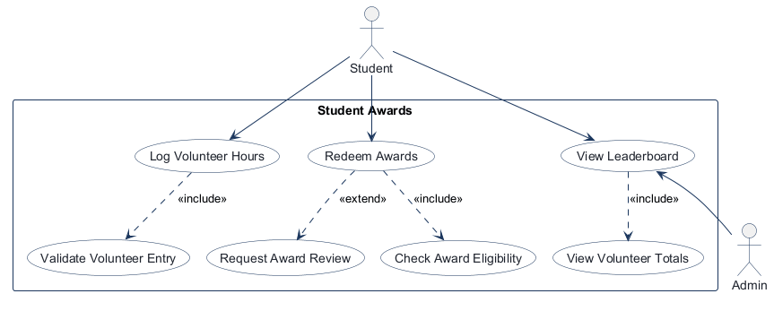
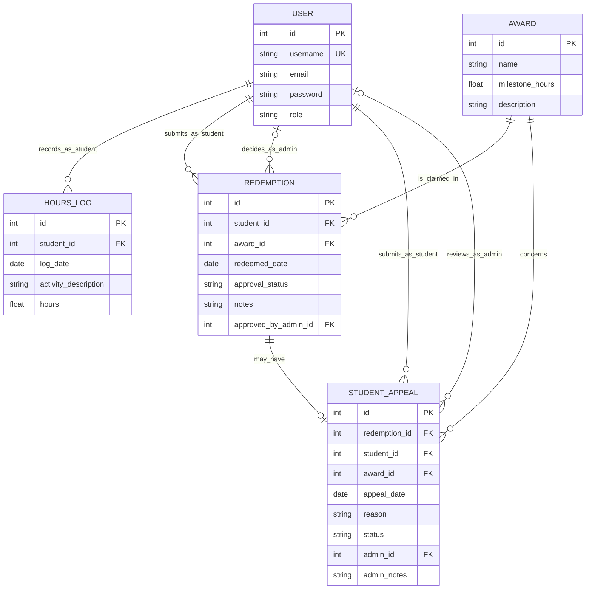
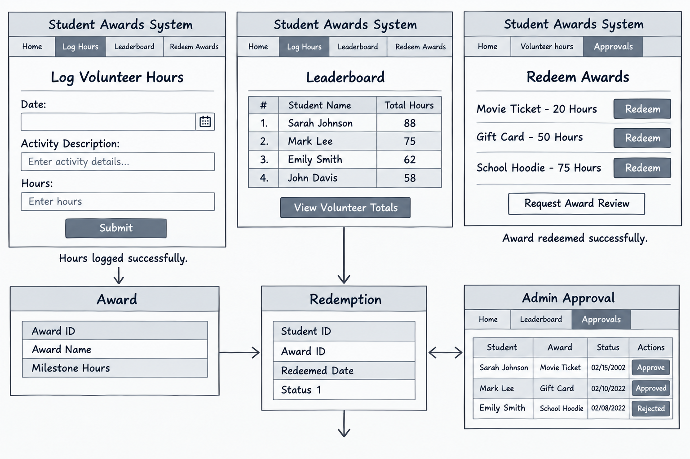
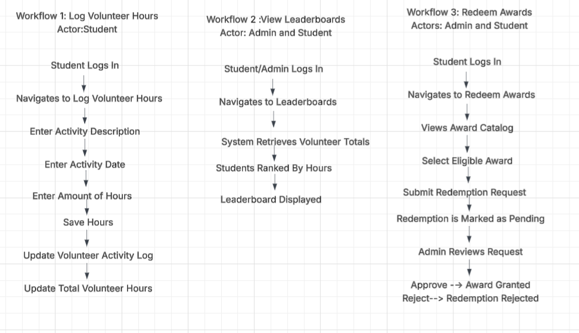

<!-- student-build:skill-integrity
status: pass
root: e84cd692d0b85eefe546385661958c27d07e8be6c5176a82012f68ccff5c8beb
expected_root: e84cd692d0b85eefe546385661958c27d07e8be6c5176a82012f68ccff5c8beb
mismatches: none
-->

# COMP 3613 Assignment 2

Draft this file with the Guide. **Update it after every phase milestone** before you pause. The use-case diagram is a UML PNG at `docs/diagrams/use-case.png`, linked from this file as `diagrams/use-case.png` (path relative to `docs/report.md`). The model diagram is Mermaid. **Embed wireframe images** as `wireframes/<file>` (files live in `docs/wireframes/`).

Do not put your student ID in this file if you will commit it. The PDF cover adds your name and ID at export time.

## Assigned project
Student Awards (incentive system)

## Three workflows

### 1. Log Volunteer Hours (Student)

### 2. View Leaderboard (Student/Admin)

### 3. Redeem Awards (Student)

## Use case diagram

Notes: Log Volunteer Hours includes validating the volunteer entry before credit is added; Redeem Awards includes checking award eligibility before a redemption is approved and optionally extends Request Award Review when an award needs manual approval; View Leaderboard is shared by Student and Admin and includes a shared totals view. The Student Appeal workflow was added during Phase 5 as an extension to the denied-redemption path.

## Model diagram

The implementation uses FastStarter's `User` table for both student and admin accounts; `role` distinguishes the two, and admin-only routes enforce that role. Hours, redemptions, and appeals reference that shared table rather than separate Student and Admin tables. `total_hours` is calculated from `HoursLog`; it is not stored on `User`. Each `Redemption` links one student to one reusable award and records its date, approval status, optional notes, and the admin user who decided it. A redemption remains pending until an Admin approves or rejects it. A denied redemption may have at most one appeal. Approving an appeal updates the original redemption to approved and grants the award.

Relationship and rule notes: a user with the student role can have many hours logs, redemptions, and appeals; an award can appear in many redemptions, making Student–Award many-to-many through `Redemption`. A user with the admin role can decide many redemptions and review many appeals; the corresponding admin foreign keys are optional until a decision is made. Role restrictions are enforced by the authenticated routes. Approval status is stored on each redemption (`pending`, `approved`, or `rejected`) rather than on the shared award. The unique appeal-to-redemption foreign key, service validation, and student UI enforce at most one appeal per denied redemption; once submitted, the form is replaced by the appeal status and a message that the option is closed.

## Wireframes

### Student Awards workflows

Coverage: all Phase 2 use cases have a corresponding screen or action in this combined wireframe. The award catalog uses the names and thresholds shown in the design: Movie Ticket (20 hours), Gift Card (50 hours), and School Hoodie (75 hours). The ineligible response and the student's view of a later Admin decision are not drawn; these are implementation details and do not prevent the workflows from completing, so no redraw is needed. A review request creates a pending redemption, which the Admin later approves or rejects. The student appeal and separate admin appeal-review flow were added during Phase 5 and extend the original denied-redemption path.

<!-- student-build:wireframe-coverage
use_case: Log Volunteer Hours
image: docs/wireframes/Wireframe diagram.png
covered: yes
-->

<!-- student-build:wireframe-coverage
use_case: Validate Volunteer Entry
image: docs/wireframes/Wireframe diagram.png
covered: yes
-->

<!-- student-build:wireframe-coverage
use_case: View Leaderboard
image: docs/wireframes/Wireframe diagram.png
covered: yes
-->

<!-- student-build:wireframe-coverage
use_case: View Volunteer Totals
image: docs/wireframes/Wireframe diagram.png
covered: yes
-->

<!-- student-build:wireframe-coverage
use_case: Redeem Awards
image: docs/wireframes/Wireframe diagram.png
covered: yes
-->

<!-- student-build:wireframe-coverage
use_case: Check Award Eligibility
image: docs/wireframes/Wireframe diagram.png
covered: yes
-->

<!-- student-build:wireframe-coverage
use_case: Request Award Review
image: docs/wireframes/Wireframe diagram.png
covered: yes
-->

### Wireframe diagram

## Workflows

### External workflow diagram

## User Acceptance Tests

The test diagrams below are ordered by their section and test-case numbers. UAT cases are listed first, followed by the unit and integration test plans.

### Section 1 — User Acceptance Tests

#### UAT-01 and UAT-02 — Log Volunteer Hours and View Leaderboard

#### UAT-03 — Redeem Award

#### UAT-04 and UAT-05 — Approve and Reject Redemption

### Section 2 — Unit Test Plan

### Section 3 — Integration Test Plan

#### IT-01 — Student Logs Hours and Leaderboard Updates

#### IT-02 and IT-03 — Admin Approves or Rejects Award

## Automated Test Results

The project test suite was run with `pytest -q` on 2026-11-09: **15 passed, 0 failed** (1.35 seconds). The passing suite includes unit coverage for redemption eligibility, duplicate requests, retry after rejection, and approval decisions, along with integration coverage for logging hours and student/admin redemption approval and rejection.

Pytest also emitted one non-blocking Starlette deprecation warning about its current `httpx` integration with `TestClient`; it did not cause a test failure.

## Theming

The Student Awards brand uses a bolder, more confident palette than the washed-out starter design: deep blue for trust and academic credibility, warm gold accents for achievement and reward, and a softened ivory background that keeps the interface readable without losing the premium student-facing feel. The display font is a strong serif wordmark for the brand and the body font stays modern and clear for forms and dashboards. The same palette and typography are applied across the landing page, login, registration, and authenticated dashboard so the app feels like one consistent product rather than a generic starter theme.

## Implementation notes

The app was implemented using the required layered architecture: routes call the Student Awards service, which delegates persistence to repositories, while models represent the stored entities. Student workflows cover logging volunteer hours, viewing the leaderboard, and redeeming awards; admin workflows cover reviewing redemptions and student appeals. The award catalog matches the Phase 4 wireframe: Movie Ticket at 20 hours, Gift Card at 50 hours, and School Hoodie at 75 hours. Original local SVG illustrations of those rewards appear in the catalog and Personal Awards. These are seeded as the current catalog; older award rows are retained for historical redemptions and appeals, and are not shown as current catalog choices. Student-only routes reject admin accounts, and award requests are offered only when the student has enough logged hours and has no pending or previously approved request for that award. Admin decisions are limited to pending redemptions. A denied request may receive one student appeal; the separate admin Student Appeals page allows approval or denial, and approval grants the award by updating the original redemption. Students can see appeal outcomes and admin notes in award activity, and approved awards—including appeal-approved awards—appear in Personal Awards. Public, authentication, and authenticated pages share the blue-and-ivory theme; the authenticated shell has a viewport-height, role-aware sidebar with a footer-anchored logout action.

As a Phase 5 polish update, student sections (hours, leaderboard, award catalog, activity, and Personal Awards) and admin sections (overview, leaderboard, redemption review, and appeals) are available as separate pages. The home pages provide uncluttered section links, and the shared authenticated navigation includes a Back control. The student verified that both student and admin pages navigate as intended.

## Deployed app

Phase 6 started. The app is verified locally and ready for Render deployment, but the Render MCP connection is not authenticated in this session yet, so the live public URL is still pending.

https://pending-render-deploy

## Logins

Every account a marker needs, including extra users you added. Starter accounts:

- bob / bobpass — regular user
- admin / adminpass — admin

## YouTube URL

https://www.youtube.com/watch?v=b3gu53tiZSE

## Session transcripts

Filled when the Guide builds the report: the agent writes chat markdown into `docs/transcripts/`; `python manage.py report` packages them.

Guide packaged **8** chat(s) in `docs/transcripts/` (and `docs/transcripts.zip`).

Index: [docs/transcripts/INDEX.md](transcripts/INDEX.md)

- [`phase-2-use-case`](transcripts/phase-2-use-case.md)
- [`phase-3-model`](transcripts/phase-3-model.md)
- [`phase-4-wireframes`](transcripts/phase-4-wireframes.md)
- [`phase-5-theming-build`](transcripts/phase-5-theming-build.md)
- [`phase-6-deploy`](transcripts/phase-6-deploy.md)
- [`test-suite-report-update`](transcripts/test-suite-report-update.md)
- [`user-acceptance-tests-report-update`](transcripts/user-acceptance-tests-report-update.md)
- [`workflow-report-update`](transcripts/workflow-report-update.md)

## Competency (student-judge)

Filled by Guide from the student-judge run when this report was built.

**Student / session:** Student Awards project / COMP 3613 Assignment 2
**Artifact:** Available Guide-written phase transcripts, current `docs/report.md`, diagrams, wireframes, and test suite
**Phases in evidence:** 1–6 (COMP 3613; Phase 5 polish, Phase 6 deploy partial; never generic 0–5)

**Judged at:** 2026-11-09T16:07:00-04:00
**Evidence pass:** Re-read current `docs/report.md`, `docs/diagrams/`, `docs/wireframes/`, and all available Guide transcript markdown; checked the current test suite result. Older native Copilot CLI chats were not readable. Prior scorecard ignored.

### Totals
| | Count / value |
|--|--|
| Metrics on rubric | 12 (M1–M12) |
| N/A (excluded) | 0 |
| Metrics scored | 12 |
| Scoreable max | 48 |
| Awarded total | 38 / 48 |
| **Overall (avg of scored)** | **3.2 / 4** |
| Impression mark | 16 / 20 |

## Scorecard

| ID | Metric | Score / 4 | In avg | Evidence |
|----|--------|----------:|:------:|----------|
| M1 | Phase discipline | 3 | yes | The report documents Phases 1–5 before Phase 6, which remains pending a public URL. |
| M2 | Problem framing | 3 | yes | The report names Student Awards and three workflows; the Phase 2 transcript records the student asking “does nothing extend?” and choosing “add one extend.” |
| M3 | Decision ownership | 3 | yes | The Phase 3 transcript records the student's entity/property list and relationship decisions; later report content follows the student's chosen theme and workflows. |
| M4 | Artefact-before-code | 3 | yes | The ERD, use-case diagram, and student wireframe are present; implementation notes correspond to the same workflows. |
| M5 | Verification habit | 3 | yes | The report records local verification and student/admin navigation checks; the latest full test run is documented as 15 passing cases. |
| M6 | Assignment fit | 3 | yes | The report describes the Student Awards model and layered implementation, followed by polish and a pending deployment. |
| M7 | Slice explanation | 3 | yes | Transcripts summarize relationship and architecture checks; model notes describe eligibility, redemption status, and appeal rules. |
| M8 | Prompt quality | 3 | yes | Transcripts show phase-oriented prompts; the student also asked for redemption tests to match the current workflow and designed app. |
| M9 | Response to pushback | 3 | yes | The student engaged the include/extend discussion and continued steering test coverage after learning the existing unit test did not represent the full workflow. |
| M10 | Integrity | 4 | yes | The current report's course skill-integrity marker is `pass`; available transcripts show no paste-back or answer-seeking flags. |
| M11 | Provenance continuity | 3 | yes | The workflows, model, UI, and current tests remain about the same Student Awards system and its documented redemption states. |
| M12 | Sincerity trajectory | 4 | yes | No suspicion rounds or sincerity blocks appear in the accessible transcript set; no suspicion spiral was needed. |

## Strengths
- The report and diagrams consistently describe the Student Awards project and its three named workflows.
- The student supplied a wireframe, external workflow diagram, and six test-plan diagrams; the report orders the acceptance, unit, and integration test plans.
- The project test suite currently passes: **15 passed, 0 failed**. Redemption unit and integration coverage follows the app's implemented request and admin decision flows.
- The report records Phase 5 local verification and polish before the Phase 6 deployment step.

## Gaps (priority order)
1. Phase 6 remains partial: `docs/report.md` contains `https://pending-render-deploy` rather than a live public Render URL.

## Phase gate status
| Phase | Status | Note |
|-------|--------|------|
| 1 | met | Project and three workflows are documented; a separate Phase 1 chat was not available in the accessible transcript set. |
| 2 | met | Use-case diagram and include/extend choice are recorded. |
| 3 | met | Student entities, properties, and relationship discussion are summarized in the transcript. |
| 4 | met | Student wireframe is embedded and coverage is recorded. |
| 5 | met | Theme, implementation, local verification, and polish are recorded in the report. |
| 6 | partial | The public Render URL is still pending. |

## Recommended next practice
- Complete the Render Postgres and web-service deployment, then replace the pending URL in the report with the live app URL.

## Integrity note
- Clean based on the accessible evidence.
- Older native Copilot CLI chats could not be read; available Guide-written transcripts and project artifacts were used.

## Provenance flags
- None observed.

## Sincerity log summary
- Blocks found: 0 in accessible transcripts
- max round: 0
- min/mean/final confidence: n/a
- trend: n/a
- cleared: no suspicion spiral needed

## Skips
- Skips: 0/3 used (from available Guide evidence). Skips are not an integrity failure.

## Skill integrity

Course skills are hashed at export and compared to `.agents/skills.lock.json`. Do not edit `.agents/skills/`, `.cursor/skills/`, or `AGENTS.md`.

- Status: **pass**
- Root: `e84cd692d0b85eefe546385661958c27d07e8be6c5176a82012f68ccff5c8beb`
- none
