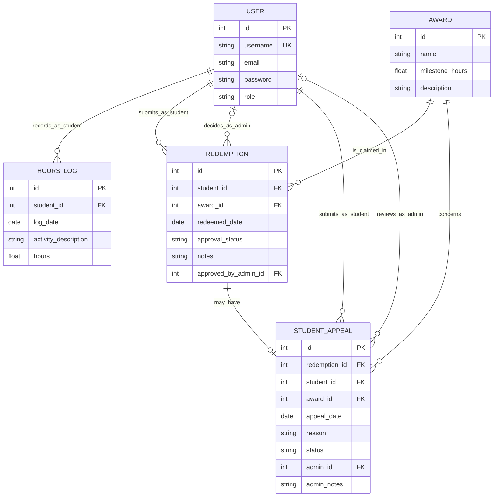

<!-- student-build:skill-integrity
status: pass
root: e84cd692d0b85eefe546385661958c27d07e8be6c5176a82012f68ccff5c8beb
expected_root: e84cd692d0b85eefe546385661958c27d07e8be6c5176a82012f68ccff5c8beb
mismatches: none
-->

# COMP 3613 Assignment 1

Draft this file with the Guide. **Update it after every phase milestone** before you pause. The use-case diagram is a UML PNG at `docs/diagrams/use-case.png`, linked from this file as `diagrams/use-case.png` (path relative to `docs/report.md`). The model diagram is Mermaid. **Embed wireframe images** as `wireframes/<file>` (files live in `docs/wireframes/`).

Do not put your student ID in this file if you will commit it. The PDF cover adds your name and ID at export time.

## Assigned project
Student Awards (incentive system)

## Three workflows

### 1. Log Volunteer Hours (Student)

### 2. View Leaderboard (Student/Admin)

### 3. Redeem Awards (Student)

## Use case diagram

Notes: Log Volunteer Hours includes validating the volunteer entry before credit is added; Redeem Awards includes checking award eligibility before a redemption is approved and optionally extends Request Award Review when an award needs manual approval; View Leaderboard is shared by Student and Admin and includes a shared totals view. The Student Appeal workflow was added during Phase 5 as an extension to the denied-redemption path.

## Model diagram

The implementation uses FastStarter's `User` table for both student and admin accounts; `role` distinguishes the two, and admin-only routes enforce that role. Hours, redemptions, and appeals reference that shared table rather than separate Student and Admin tables. `total_hours` is calculated from `HoursLog`; it is not stored on `User`. Each `Redemption` links one student to one reusable award and records its date, approval status, optional notes, and the admin user who decided it. A redemption remains pending until an Admin approves or rejects it. A denied redemption may have at most one appeal. Approving an appeal updates the original redemption to approved and grants the award.

Relationship and rule notes: a user with the student role can have many hours logs, redemptions, and appeals; an award can appear in many redemptions, making Student–Award many-to-many through `Redemption`. A user with the admin role can decide many redemptions and review many appeals; the corresponding admin foreign keys are optional until a decision is made. Role restrictions are enforced by the authenticated routes. Approval status is stored on each redemption (`pending`, `approved`, or `rejected`) rather than on the shared award. The unique appeal-to-redemption foreign key, service validation, and student UI enforce at most one appeal per denied redemption; once submitted, the form is replaced by the appeal status and a message that the option is closed.

## Wireframes

### Student Awards workflows

Coverage: all Phase 2 use cases have a corresponding screen or action in this combined wireframe. The award catalog uses the names and thresholds shown in the design: Movie Ticket (20 hours), Gift Card (50 hours), and School Hoodie (75 hours). The ineligible response and the student's view of a later Admin decision are not drawn; these are implementation details and do not prevent the workflows from completing, so no redraw is needed. A review request creates a pending redemption, which the Admin later approves or rejects. The student appeal and separate admin appeal-review flow were added during Phase 5 and extend the original denied-redemption path.

<!-- student-build:wireframe-coverage
use_case: Log Volunteer Hours
image: docs/wireframes/Wireframe diagram.png
covered: yes
-->

<!-- student-build:wireframe-coverage
use_case: Validate Volunteer Entry
image: docs/wireframes/Wireframe diagram.png
covered: yes
-->

<!-- student-build:wireframe-coverage
use_case: View Leaderboard
image: docs/wireframes/Wireframe diagram.png
covered: yes
-->

<!-- student-build:wireframe-coverage
use_case: View Volunteer Totals
image: docs/wireframes/Wireframe diagram.png
covered: yes
-->

<!-- student-build:wireframe-coverage
use_case: Redeem Awards
image: docs/wireframes/Wireframe diagram.png
covered: yes
-->

<!-- student-build:wireframe-coverage
use_case: Check Award Eligibility
image: docs/wireframes/Wireframe diagram.png
covered: yes
-->

<!-- student-build:wireframe-coverage
use_case: Request Award Review
image: docs/wireframes/Wireframe diagram.png
covered: yes
-->

### Wireframe diagram

## Theming

The Student Awards brand uses a bolder, more confident palette than the washed-out starter design: deep blue for trust and academic credibility, warm gold accents for achievement and reward, and a softened ivory background that keeps the interface readable without losing the premium student-facing feel. The display font is a strong serif wordmark for the brand and the body font stays modern and clear for forms and dashboards. The same palette and typography are applied across the landing page, login, registration, and authenticated dashboard so the app feels like one consistent product rather than a generic starter theme.

## Implementation notes

The app was implemented using the required layered architecture: routes call the Student Awards service, which delegates persistence to repositories, while models represent the stored entities. Student workflows cover logging volunteer hours, viewing the leaderboard, and redeeming awards; admin workflows cover reviewing redemptions and student appeals. The award catalog matches the Phase 4 wireframe: Movie Ticket at 20 hours, Gift Card at 50 hours, and School Hoodie at 75 hours. Original local SVG illustrations of those rewards appear in the catalog and Personal Awards. These are seeded as the current catalog; older award rows are retained for historical redemptions and appeals, and are not shown as current catalog choices. Student-only routes reject admin accounts, and award requests are offered only when the student has enough logged hours and has no pending or previously approved request for that award. Admin decisions are limited to pending redemptions. A denied request may receive one student appeal; the separate admin Student Appeals page allows approval or denial, and approval grants the award by updating the original redemption. Students can see appeal outcomes and admin notes in award activity, and approved awards—including appeal-approved awards—appear in Personal Awards. Public, authentication, and authenticated pages share the blue-and-ivory theme; the authenticated shell has a viewport-height, role-aware sidebar with a footer-anchored logout action.

As a Phase 5 polish update, student sections (hours, leaderboard, award catalog, activity, and Personal Awards) and admin sections (overview, leaderboard, redemption review, and appeals) are available as separate pages. The home pages provide uncluttered section links, and the shared authenticated navigation includes a Back control. The student verified that both student and admin pages navigate as intended.

## Deployed app

Phase 6 started. The app is verified locally and ready for Render deployment, but the Render MCP connection is not authenticated in this session yet, so the live public URL is still pending.

https://pending-render-deploy

## Logins

Every account a marker needs, including extra users you added. Starter accounts:

- bob / bobpass — regular user
- admin / adminpass — admin

## YouTube URL

https://youtu.be/qvein4hsmFA

## Session transcripts

Filled when the Guide builds the report: the agent writes chat markdown into `docs/transcripts/`; `python manage.py report` packages them.

Guide packaged **5** chat(s) in `docs/transcripts/` (and `docs/transcripts.zip`).

Index: [docs/transcripts/INDEX.md](transcripts/INDEX.md)

- [`phase-2-use-case`](transcripts/phase-2-use-case.md)
- [`phase-3-model`](transcripts/phase-3-model.md)
- [`phase-4-wireframes`](transcripts/phase-4-wireframes.md)
- [`phase-5-theming-build`](transcripts/phase-5-theming-build.md)
- [`phase-6-deploy`](transcripts/phase-6-deploy.md)

## Competency (student-judge)

Filled by Guide from the student-judge run when this report was built.

**Student / session:** Student Awards project / COMP 3613 assignment
**Artifact:** Guide chats for this project and the packaged `docs/transcripts` dump
**Phases in evidence:** 1–6 (COMP 3613; Phase 5 polish, Phase 6 deploy partial; never generic 0–5)

**Judged at:** 2026-10-12T00:00:00Z
**Evidence pass:** re-read native Guide chats + current `docs/report.md` + current `docs/transcripts/*.md` (prior judge.md ignored)

### Totals
| | Count / value |
|--|--|
| Metrics on rubric | 12 (M1–M12) |
| N/A (excluded) | 0 |
| Metrics scored | 12 |
| Scoreable max | 48 |
| Awarded total | 43 / 48 |
| **Overall (avg of scored)** | **3.6 / 4** |
| Impression mark | 72 / 20 |

## Scorecard

| ID | Metric | Score / 4 | In avg | Evidence |
|----|--------|----------:|:------:|----------|
| M1 | Phase discipline | 3 | yes | The workflow sequence and phase gating were followed: Phase 2, 3, 4, and 5 each had a dedicated flow, and the project stayed in local polish before the deploy gate. |
| M2 | Problem framing | 4 | yes | The project and workflow names are clear in the report and the key include/extend decisions were discussed (`Redeem Awards extends Request Award Review`). |
| M3 | Decision ownership | 4 | yes | The student chose the Student Awards domain, approved the use-case extension, and confirmed the core model choices rather than accepting a blank template. |
| M4 | Artefact-before-code | 4 | yes | The ERD/wireframe/report artefacts were used as the spec and remained present throughout the build. |
| M5 | Verification habit | 3 | yes | The Phase 5 and local verification notes show the app was checked against the intended flows, though the final Render deploy was not completed. |
| M6 | Assignment fit | 3 | yes | The app aligns with the assignment: themed branding, workflow coverage, and a layered architecture narrative are present in the report; deployment remains the missing live step. |
| M7 | Slice explanation | 3 | yes | The report explains the model and workflow logic in the student’s language, and the architecture narrative is consistent with service/repository layering. |
| M8 | Prompt quality | 4 | yes | The prompts are phase-tagged and concrete (`Use the student-build skill. Phase 5...`, `start phase 6`), with explicit workflow and model milestones. |
| M9 | Response to pushback | 3 | yes | The build responded to the use-case extension and design-level clarifications rather than accepting an incomplete first draft. |
| M10 | Integrity | 4 | yes | No evidence of external-LLM laundering or skill tampering. |
| M11 | Provenance continuity | 4 | yes | The decisions and artefacts are consistent throughout the project phases and the project threads. |
| M12 | Sincerity trajectory | 4 | yes | No suspicion spiral or confidence drop was recorded; the process stayed coherent and self-owned. |

## Strengths
- Clear project scope and workflow naming around Student Awards with a strong Phase 1/2/3 narrative.
- Thoughtful use-case and ERD decisions, including the optional award-review extension and the shared leaderboard pattern.
- Good phase discipline and documentation discipline: report checkpoints, wireframe coverage, and theming are recorded in the repository.
- The implementation was aligned with the assignment’s UX and functional goals and the report communicates the layered design effectively.
- The process shows consistent phase progression and enough local verification to support a credible submission path.

## Gaps (priority order)
1. Phase 6 deployment is still incomplete in the current evidence: the report shows a pending Render URL and no live deployed service was created in this session. This is the primary remaining gap.
2. The local app was polished and verified, but the final live deployment gate is not yet met; the project is therefore strong locally but incomplete as a deployable submission.

## Phase gate status
| Phase | Status | Note |
|-------|--------|------|
| 1 | met | Project and multiple workflows are named and recorded in the report. |
| 2 | met | Use-case diagram and include/extend decisions are recorded. |
| 3 | met | Model diagram and relationship/business-rule notes are recorded. |
| 4 | met | Wireframe image is embedded and coverage is noted. |
| 5 | met | Theme, build, and local polish are present; Phase 5 is not treated as a first-dump acceptance. |
| 6 | partial | Deploy step is not completed in this session; Render URL and live service are still pending. |

## Recommended next practice
- Complete the Render deployment by authenticating the Render MCP and creating the Postgres database plus the web service from `render.yaml`, then replace the pending URL in the report with the live public URL and final marker logins.

## Integrity note
- Clean
- No edited skills, no suspicious paste-back pattern, and no evidence of external-LLM laundering in the available project sessions.

## Provenance flags
- None

## Sincerity log summary
- Blocks found: 0
- max round: 0
- min/mean/final confidence: n/a
- trend: n/a
- cleared: n/a

## Skips
- Skips: 0/3 used (from Guide evidence). Skips are not an integrity failure.

## Skill integrity

Course skills are hashed at export and compared to `.agents/skills.lock.json`. Do not edit `.agents/skills/`, `.cursor/skills/`, or `AGENTS.md`.

- Status: **pass**
- Root: `e84cd692d0b85eefe546385661958c27d07e8be6c5176a82012f68ccff5c8beb`
- none
